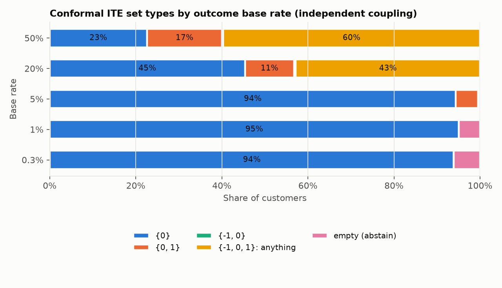
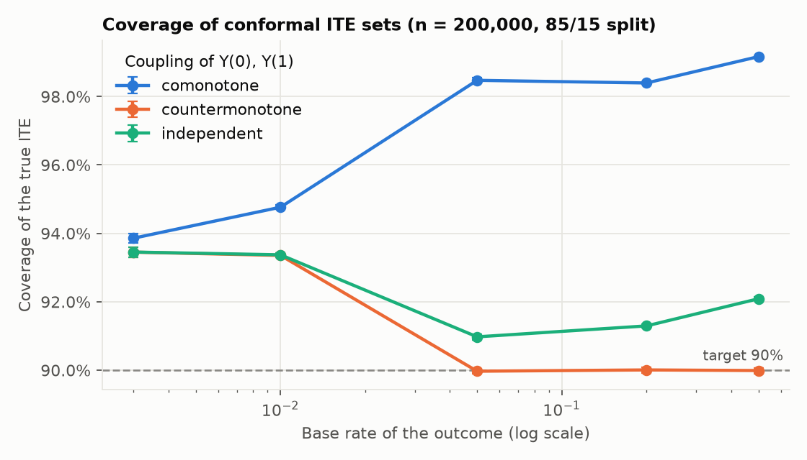
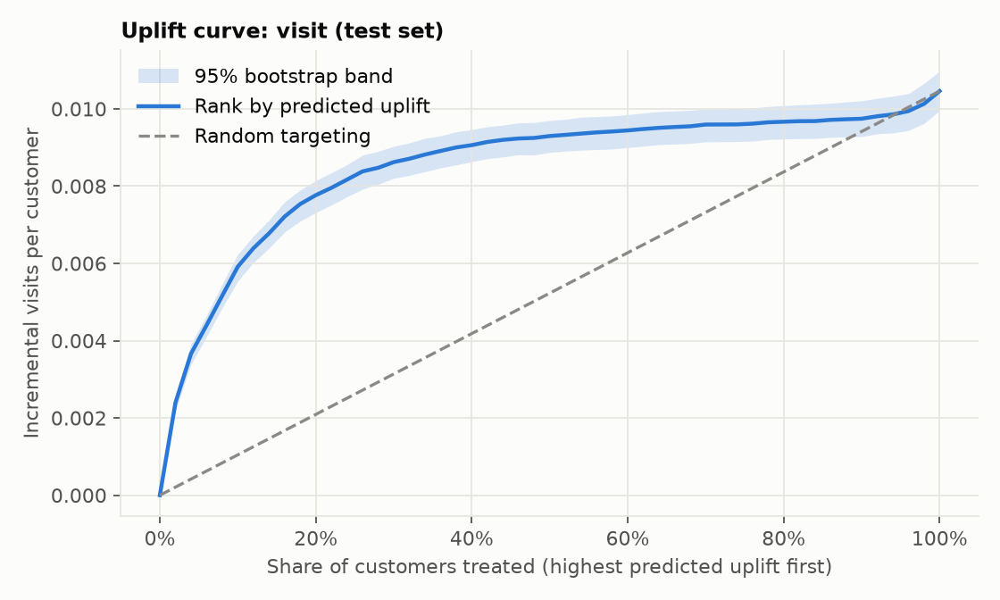
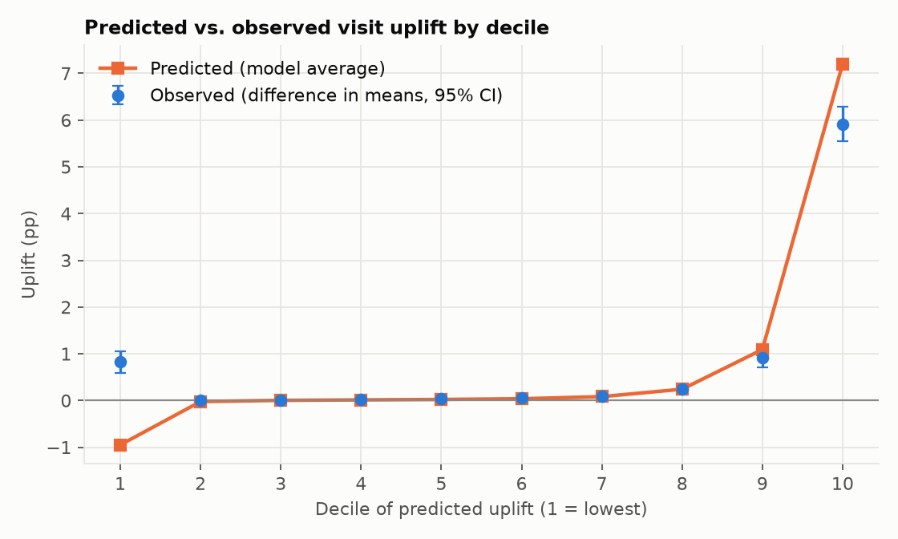
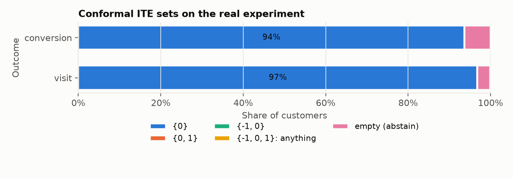
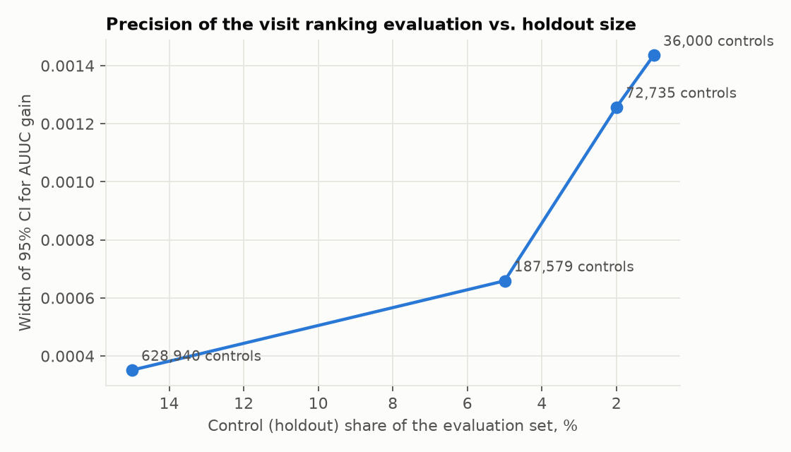

# What Can Distribution-Free Uncertainty Say About *Who* Benefits? Conformal Uplift on a 14-Million-User Randomized Ad Experiment

[](https://github.com/himu278/conformal-uplift-criteo/actions/workflows/tests.yml)


Teams that target marketing with uplift models usually rank customers by a *point* estimate of
the treatment effect. The harder question is how sure we can be that a particular customer
benefits. Conformal prediction promises distribution-free, finite-sample guarantees for exactly
this kind of individual-level statement (Lei & Candès, 2021). This project tests what those
guarantees deliver when outcomes are **binary and rare**, which is the normal case in
advertising and e-commerce. It uses a simulation study with known ground truth and the
Criteo Uplift v2.1 randomized experiment (13,979,592 users).

**Stack:** Python (NumPy, SciPy, pandas, scikit-learn, matplotlib) · DuckDB/SQL on Parquet · pytest · GitHub Actions

---

## Research question

For a randomized experiment with a binary outcome *Y* and treatment *T*:

1. Do split-conformal sets for the individual treatment effect *Y*(1) − *Y*(0) keep their
   coverage guarantee under severe treatment imbalance (85/15, 95/5) and rare outcomes?
2. Are they **informative**: how often does a set exclude zero, or certify a benefit?
3. When individual-level statements are uninformative, what can a team still learn at the
   group level, and how does the size of the control holdout limit it?

The key structural fact: with binary outcomes, an experiment identifies the two marginals
P(*Y*(1)=1 | *x*) and P(*Y*(0)=1 | *x*), but **not** their joint distribution (Zhang & Richardson,
2025). The simulation therefore evaluates every method under three couplings of
(*Y*(0), *Y*(1)) that produce identical observed data.

## Findings

### Simulation (ground truth known)
<!-- SIM:START -->
*Simulation: 50 replications per cell; target ITE coverage 90%.*

- **Validity holds.** No cell's mean ITE coverage is below the target by more than two Monte Carlo standard errors. Lowest mean coverage across all cells: 89.9%; at n = 200,000 with an 85/15 split: 90.0%.
- **How informative are the sets?** With n = 200,000 and an 85/15 split (independent coupling):

| Base rate | ITE set = {0} | ITE set = {-1,0,1} | Set excludes 0 | Empty set | Decile CIs excluding 0 | Decile CI coverage (target 95%) |
|---|---|---|---|---|---|---|
| 0.3% | 93.9% | 0.0% | 0.00% | 6.1% | 28% | 86% |
| 1.0% | 95.1% | 0.0% | 0.00% | 4.9% | 23% | 93% |
| 5.0% | 94.4% | 0.2% | 0.00% | 0.2% | 38% | 97% |
| 20.0% | 45.4% | 42.8% | 0.00% | 0.0% | 67% | 95% |
| 50.0% | 22.6% | 59.7% | 0.00% | 0.0% | 70% | 95% |

- An ITE set of {0} is *valid* but is not evidence of no effect: it appears because almost nobody has the outcome in either arm. The largest share of sets that certify a benefit ({1}) in any cell is 0.00%. The "Decile CIs excluding 0" column shows how often decile-level difference-in-means intervals, the group-level alternative, exclude zero.
- The group-level alternative has its own failure mode: the decile intervals are Wald intervals, and their mean coverage of the true decile effect ranges from 62% to 97% across cells (target 95%). Low values occur where a decile's control group has very few events (rare outcomes, small holdouts).
<!-- SIM:END -->

<p>
  
  
</p>

### Criteo Uplift v2.1 (real randomized experiment)
<!-- REAL:START -->
*Criteo Uplift v2.1: 13,979,592 rows; treatment share 85.00% (SRM p = 0.999); max |SMD| across features 0.0488.*

| Outcome | Treated | Control | ITT effect | 95% CI | Relative lift |
|---|---|---|---|---|---|
| visit | 4.854% | 3.820% | +1.034 pp | [+1.006 pp, +1.063 pp] | 27.1% |
| conversion | 0.309% | 0.194% | +0.115 pp | [+0.108 pp, +0.122 pp] | 59.4% |

**Visit**
- Conformal sets: factual coverage 95.01% (treated) and 95.09% (control), target 95% each. ITE sets: 96.8% are {0}, 0.06% exclude 0, 3.2% are empty.
- Ranking: AUUC gain over random (x1,000) 3.284 (95% CI [3.076, 3.448]). Treating the top 10% captures 57% of the total effect (random: 10%).

**Conversion**
- Conformal sets: factual coverage 95.00% (treated) and 95.01% (control), target 95% each. ITE sets: 93.7% are {0}, 0.00% exclude 0, 6.3% are empty.
- Ranking: AUUC gain over random (x1,000) 0.242 (95% CI [0.188, 0.313]). Treating the top 10% captures 60% of the total effect (random: 10%).

<!-- REAL:END -->


#### What the real-data results mean
- **Individual-level sets carry almost no decision information.** Both arms hit their 95% factual-coverage target, but 96.8% (visit) and 93.7% (conversion) of ITE sets are {0}. Only 0.06% of visit sets certify a benefit ({1}); these users deserve separate scrutiny because they are where the two arm models disagree most.
- **Group-level ranking is strong.** Treating the top 10% by predicted uplift captures 57% (visit) and 60% (conversion) of the total effect, vs. 10% for random targeting.
- **Calibration is good in the middle but not at the extremes.** The model overstates the top decile (7.2 vs. 5.9 pp observed) and gets the sign wrong in the bottom decile (−0.95 predicted vs. +0.82 pp observed), so these scores should not be used to exclude the lowest decile.
- **Holdout size matters.** Shrinking the control share from 15% to 1% widens the AUUC confidence interval about fourfold.
- **Exposure is selected, not randomized.** A naive exposed-vs-control comparison gives +37.8 pp for visits against an ITT effect of +1.0 pp; treated users who were never exposed visit less often (3.49%) than controls (3.82%).
- **Balance caveat.** The sample-ratio test passes (p = 0.999) and every |SMD| is below 0.05, but at this sample size an SMD of 0.049 (f3) is roughly 65 standard errors from zero, more than randomization alone would produce. Criteo built v2 by pooling tests sub-sampled to a common treatment ratio, which may leave residual imbalance; Diemert et al.'s classifier test did not reject independence (p = 0.137). Effects are reported as intention-to-treat, and small subgroup differences should be read with caution.


<p>
  
  
</p>
<p>
  
  
</p>

Full tables: [`reports/simulation.md`](reports/simulation.md) · [`reports/results.md`](reports/results.md)

## Methods

| Step | Method | Why |
|---|---|---|
| Data audit | DuckDB SQL on Parquet: integrity rules, sample-ratio mismatch vs. the published 0.85 split, standardized mean differences, distinct-value counts | An experiment is only analysed after it is shown to be healthy |
| Point uplift | T-learner (gradient boosting per arm) | Simple, standard baseline (Diemert et al., 2018) |
| Individual uncertainty | Split-conformal sets for *Y*(1) and *Y*(0) at level α/2 each; ITE set = all differences (naive construction of Lei & Candès, 2021) | Finite-sample marginal coverage ≥ 1 − α for **any** coupling, by the union bound |
| Ground truth | Simulated experiments: base rate 0.3%–50%, treatment share 0.50/0.85/0.95, n = 20k/200k, three couplings, 50 replications per cell | Coverage of the true ITE cannot be measured on real data |
| Real-data validity check | Factual coverage within each arm on held-out users | Under randomization this equals counterfactual coverage |
| Group-level inference | Decile calibration: predicted uplift vs. difference in means with 95% CIs | What remains when individual sets say nothing |
| Ranking quality | Uplift curve and AUUC gain over random targeting, Poisson-bootstrap CIs | No re-sorting needed, so it scales to millions of rows |
| Holdout size | Subsample the control group to 15%, 5%, 2%, 1% | Industry holdouts are small; how much evaluation precision is lost? |
| Assignment vs. exposure | ITT, naive exposed-vs-control, complier (Wald/IV) effect | Exposure depends on ad auctions and is not randomized |

## Design decisions

- **The estimand is intention-to-treat** (effect of the randomized `treatment`). `exposure` is
  used only for the separate complier analysis, under an explicitly stated exclusion restriction.
- **Validity is tested, not assumed.** Coverage is checked against ground truth in simulation
  and against held-out factual outcomes on real data. A floating-point tie bug that broke
  coverage for constant models was caught by the simulation and is covered by a regression test.
- **Empty sets are reported as abstentions**, not as "excludes zero".
- **Every sentence in the reports is generated from the computed numbers**, so text and
  tables cannot drift apart.
- **No data are committed.** The download script fetches the official file and verifies its
  published SHA256 checksum.

## Repository structure

```
├── sql/                     # audit queries (DuckDB; SQLite-compatible for tests)
├── src/conformal_uplift/
│   ├── data.py              # download, checksum, CSV.gz -> Parquet
│   ├── audit.py             # integrity, SRM, balance, exposure funnel
│   ├── conformal.py         # binary conformal sets, ITE sets, informativeness
│   ├── simulate.py          # experiments with known potential outcomes and couplings
│   ├── sim_study.py         # simulation grid
│   ├── uplift.py            # T-learner, uplift curve, bootstrap, deciles, policy table
│   ├── real_study.py        # real-data analysis, holdout study, exposure analysis
│   ├── plots.py / report.py # figures and generated markdown
├── scripts/                 # download_data.py, run_audit.py, run_simulation.py, run_real.py
├── tests/                   # exact-coverage, coupling, ranking and pipeline tests
├── docs/methods_note.md     # short technical note
└── reports/                 # generated figures, tables and results
```

## How to run

```bash
git clone https://github.com/himu278/conformal-uplift-criteo.git
cd conformal-uplift-criteo
pip install -r requirements.txt

pytest                                   # unit tests (about 10 seconds)
python scripts/run_simulation.py         # simulation study (about 1-5 minutes)
python scripts/download_data.py          # ~300 MB download, checksum, Parquet
python scripts/run_audit.py              # experiment health checks
python scripts/run_real.py               # full analysis (needs about 4 GB free RAM)
python scripts/run_real.py --max-rows 3000000   # smaller machines (README is not updated)
```

## Limitations

- Coverage is **marginal** (on average over users), not conditional on a user's features.
- Only the naive ITE construction is implemented; nested constructions (Lei & Candès, 2021)
  and conformal meta-learners (Alaa et al., 2023) are on the roadmap.
- Criteo sub-sampled the data non-uniformly for privacy, so absolute rates and lifts describe
  the released sample, not real advertising effectiveness (Criteo AI Lab).
- Criteo features are anonymized random projections; no business interpretation of
  individual features is possible.
- Decile intervals use the normal approximation, which undercovers when a decile's control
  group has very few events (see the simulation).

## Roadmap

- Conformal p-values with Benjamini–Hochberg selection of likely beneficiaries (Jin & Candès).
- Targeting policies with explicit harm-rate control (Jin & Egami).
- Nested ITE sets and conformal meta-learners; comparison with `cfcausal` (R).

## Data and license

Criteo Uplift Prediction Dataset v2.1, Criteo AI Lab
([dataset page](https://ailab.criteo.com/criteo-uplift-prediction-dataset/),
[Hugging Face mirror](https://huggingface.co/datasets/criteo/criteo-uplift)), licensed
**CC BY-NC-SA 4.0**. The data are not redistributed here. This repository's code is MIT
licensed; the data license is separate.

## References

- Diemert, E., Betlei, A., Renaudin, C., Amini, M.-R. (2018). A Large Scale Benchmark for Uplift Modeling. AdKDD & TargetAd Workshop, KDD. Extended version: arXiv:2111.10106.
- Lei, L., Candès, E. J. (2021). Conformal inference of counterfactuals and individual treatment effects. *JRSS-B* 83(5), 911–938.
- Alaa, A., Ahmad, Z., van der Laan, M. (2023). Conformal meta-learners for predictive inference of individual treatment effects. NeurIPS.
- Zhang, Richardson (2025). Individual Treatment Effect: Prediction Intervals and Sharp Bounds. arXiv:2506.07469.
- Leng, Y., Dimmery, D. (2024). Calibration of Heterogeneous Treatment Effects in Randomized Experiments. *Information Systems Research* 35(4), 1721–1742.
- Yadlowsky, S., Fleming, S., Shah, N., Brunskill, E., Wager, S. Evaluating Treatment Prioritization Rules via Rank-Weighted Average Treatment Effects. arXiv:2111.07966.

## Author

**Umma Hafsah Himu** · Ph.D. student, Statistics and Machine Learning, Georgia State University
[GitHub](https://github.com/himu278)
